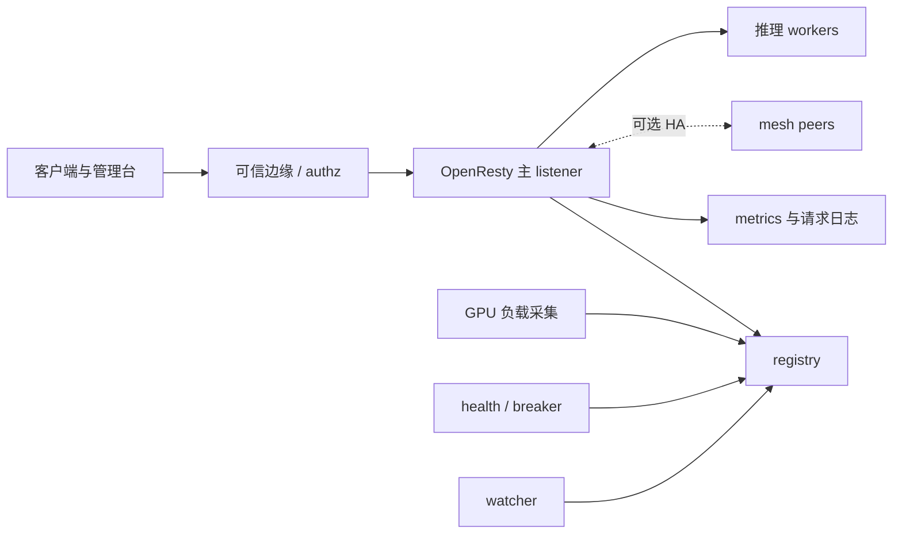
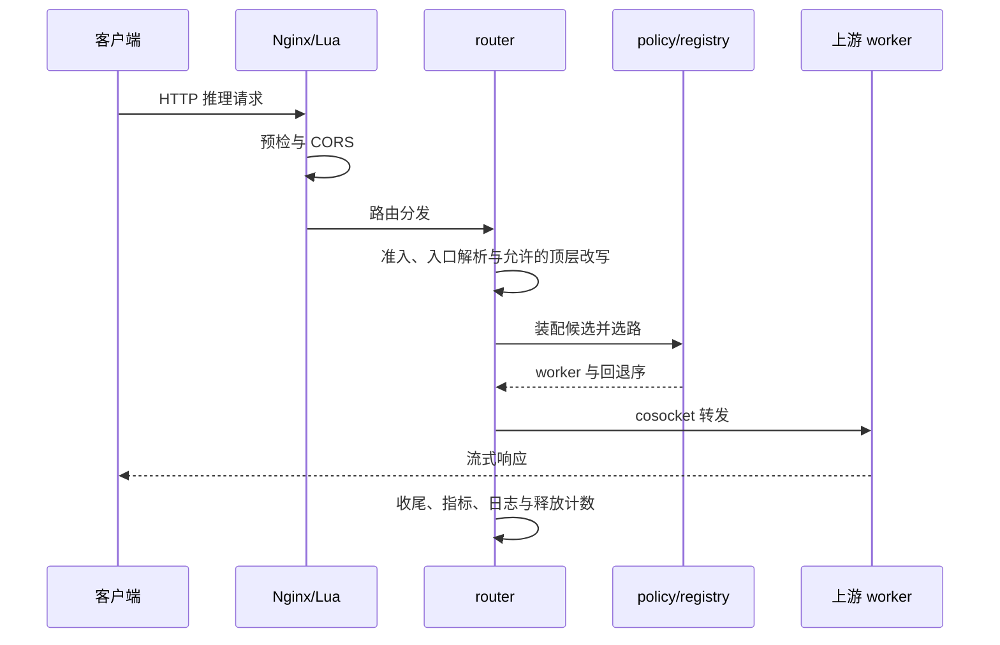

# lua-router 架构总览

本文记录当前 Lua 实现的运行模型、请求路径、模块边界和共享状态。部署操作以 [deploy.md](deploy.md) 为准，fleet 实测以 [deploy-state.md](deploy-state.md) 为准，门禁执行以 [testing-workflow.md](testing-workflow.md) 为准。配置与设计细节以对应功能文档及仓库根目录 AGENTS.md 为准。

## 图集

三张图由 [archify](https://github.com/tt-a1i/archify) 从本仓库源码取证生成，可独立打开、可导出、可搜索。它们是本文的可视化副本，事实以本文正文为准；图上的每个组件、参与者与节点都带 `文件:行号` 的源码引用，候选 JSON 与门禁回执同目录留存，可重新生成或修复。

| 图 | 打开 | 回答什么问题 |
|---|---|---|
| 系统组件与部署拓扑 | [lua-router-components.html](../.archify/architecture-lua-router-components-20261016-041957/lua-router-components.html) | 网关由哪些部件组成、哪些在容器内、状态存在哪里 |
| 推理请求生命周期 | [request-lifecycle.html](../.archify/sequence-request-lifecycle-20261016-041957/request-lifecycle.html) | 一次 `/v1/chat/completions` 从进来到记完账的每一跳 |
| 选路决策流程 | [routing-decision.html](../.archify/workflow-routing-decision-20261016-041957/routing-decision.html) | 一次请求在哪一步被放行、迁走或拒绝 |

三张图对应 `6684727`。GitHub 不内联渲染仓库里的 HTML，在 GitHub 上看图请用「Raw」打开或本地克隆后打开。

## 系统组成

lua-router 基于 OpenResty/LuaJIT，为 LLM 推理 worker 提供发现、准入、选路、流式转发、健康巡检、熔断、并发控制、管理 UI 与指标观测。服务应部署在 authz 边缘之后或可信内网中。

可交互版本见 [系统组件与部署拓扑](</.archify/architecture-lua-router-components-20261016-041957/lua-router-components.html>)。网关自身是**一个** OpenResty 容器，宿主机是 235.t / 21.k / 217.t；客户端与上游推理引擎都在容器之外。容器内的部件按职责分四层：

- **入口面**：`conf/nginx.conf.template` 的 `location /` 承载管理台静态（root 落到 `LMR_UI_DIR/admin/`），`try_files` 未命中的请求落到 `@lmr_klib` 交给 `router.handle()` 分发（template:218-251）。
- **推理面**：`router/inference.lua` 做准入与入口解析，`router/forward.lua` 做转发主循环，`router/candidates.lua` 与 `policy.lua` 做选路。
- **状态面**：`config_store` 持有声明层（sqlite 权威、file 只读镜像），`registry` 在 `lr_workers` 里持有 worker 名册与健康/熔断/负载。
- **采集与观测面**：`watcher` 发现并分档摘除实例，`gpu_load` 采利用率读数喂给容量门，`observability` 落请求日志与 Prometheus 指标。

## 运行模型

- `docker-entrypoint.sh` 归一环境变量、渲染 `conf/nginx.conf.template`、执行 `openresty -t`，然后启动 OpenResty。
- 默认策略是 `cache_aware`，亲和树住在进程内；未显式指定 worker 数时自动收敛为单 worker。启用 mesh 时同样默认单 worker。显式覆盖 `NGINX_WORKER_PROCESSES` 时需理解进程内状态不跨 worker 共享。
- 主 listener 由 `SMG_PORT` 配置（默认 30000），承载推理、管理、公开与 UI 端点；可选 `SMG_METRICS_PORT` 只出 `/metrics` 与 `/health`。主 listener 可用 TLS 环境变量就地加密。
- 管理台入口是站点根 `/`，原版 llama.cpp webui 是 `/u/`。管理面 Basic Auth 与虚拟入口 Bearer key 是两道独立门槛，覆盖面见 AGENTS.md、[gap-admin-auth.md](gap-admin-auth.md) 与 [gap-virtual-models.md](gap-virtual-models.md)。

## 推理请求生命周期

可交互版本见 [推理请求生命周期](</.archify/sequence-request-lifecycle-20261016-041957/request-lifecycle.html>)。下面的 Mermaid 是同一份事实的纯文本副本。

关键行为：

- 请求体只做允许的顶层精确改写（`set_top_field` 族），不整表重编码。调用方的 `max_tokens` / `max_completion_tokens` / `max_output_tokens` 一律原样透传，缺省时网关不代填。
- 流式响应按块转发，不缓冲整个响应；token 核算的 usage 帧处理是唯一有界帧级编辑。
- 虚拟入口映射一组真实模型，策略实例按入口名建立；候选绑定名必须落在该组内，转发体的 model 使用最终选中候选的绑定名。
- 条目 `context_window` 是对外声明的总上下文窗口，模型卡 `max_output_tokens` 是对外声明的单次最大输出；两者都只作广告，不参与任何输出预算计算。
- 候选装配依次经过健康/熔断、声明约束与绑定、模型许可、容量硬排除、虚拟组准入，再交给策略选择。容量在候选集层面硬排除，因此亲和命中也会被迁走；GPU 利用率读数未知时不因利用率门排除。
- 容量全满返回 429；不健康、熔断或组内无可用模型返回 503。watcher 严格探针按分档处置，与健康巡检、GPU 采样失败的后果不同，详见 AGENTS.md 硬规则 4 与 [gap-watcher-merge.md](gap-watcher-merge.md)。

`/v1/responses` 是转发端点，不持久化会话；`router/jsonutil.lua` 的 `patch_response_metadata` 只做协议要求的有限元数据回填。

## 选路决策

可交互版本见 [选路决策流程](</.archify/workflow-routing-decision-20261016-041957/routing-decision.html>)。请求按下面五个阶段推进，每个阶段都有各自的终态，越早终止越省代价：

1. **本机并发闸**（`limit.lua`）：`SMG_MAX_CONCURRENT_REQUESTS` 满了直接 429，请求还没进选路。
2. **入口 api-key 门**（`router/inference.lua`）：按虚拟入口判定，只认 `Authorization: Bearer <key>`，缺键与错键同一个 401；读点缺席按匿名放行，读点在场但比对失败一律拒绝。
3. **候选装配**（`router/candidates.lua` 的 `candidates_for`）：依次过健康/熔断、白名单与绑定、模型许可、容量四道门。容量是硬排除而不是排序项，被排除的实例策略根本看不见；GPU 利用率读数未知时不因利用率门排除。
4. **策略选路**（`policy.lua` + `policies/`）：8 种策略在候选集里选一台，策略实例按入口名建立，跨 worker 的游标与亲和状态在 `lr_policy`。
5. **转发**（`router/forward.lua`）：逐次改写后送出。连接失败或可重试状态码先归还在飞计数、记熔断结果、退避，再换一个候选重来，次数由 `max_retries` 封顶、耗尽答 502。

三个终态的区别是操作员排障的入口：

| 终态 | 触发条件 | 含义 |
|---|---|---|
| 401 | 入口配了密钥而请求没带或带错 | 准入门没过，与实例无关 |
| 429 | 本机闸满；或池内所有实例都被容量闸排除 | 暂时接不了单，稍后重试 |
| 503 | 熔断打开、不健康、或组内没有引擎服务目标模型 | 那个名字现在没人服务 |

三者的 `code` 在 429 与 503 上恒为 `no_available_workers`，客户端据状态码区分「退避重试」与「换名字」。`x-smg-target-worker` 头可以让某次请求钉住一台实例，但它不能复活已被容量闸排除的实例。

## 模块地图

实现位于 `lualib/resty/luarouter/`。facade 只负责稳定导出，实现住在同名子目录；跨模块引用以 facade 导出为准。

| 模块 | 职责 |
|---|---|
| `router.lua` 与 `router/` | klib 路由接线、请求准入、候选装配、推理转发、SSE、模型列表与请求日志 |
| `config_store.lua` 与 `config_store/` | 配置解析、声明层校验、热快照、持久化与配置 API |
| `registry.lua` 与 `registry/` | worker 名册、健康/熔断、模型覆盖度、容量与负载读数 |
| `policy.lua` 与 `policies/` | 策略分发、亲和状态与策略实现 |
| `watcher.lua` 与 `watcher/` | 多源发现、严格探针与 reconcile |
| `gpu_load.lua` 与 `gpu_load/` | worker metrics/Prometheus 采样、利用率归属与导出 |
| `mesh.lua` 与 `mesh/` | 可选节点间状态同步及 `/ha/*`、`/_mesh/internal/*` |
| `observability.lua` 与 `observability/` | Prometheus 指标、请求日志环形缓冲、inflight 年龄 |
| `admin_auth.lua` | 管理面 Basic Auth |
| `init.lua`、`hb.lua`、`config.lua`、`ui.lua`、`props.lua`、`limit.lua`、`httpc.lua` | 初始化与定时器、配置装配、UI API、属性代理、并发闸门、cosocket HTTP |

## 共享状态

跨 worker 的请求状态使用共享字典，定义在 `conf/nginx.conf.template`：

| 字典 | 用途 |
|---|---|
| `lr_workers` | worker 记录、健康/熔断、负载与利用率样本 |
| `lr_policy` | 策略游标、亲和树快照与策略状态 |
| `lr_stats` | 计数器、直方图与 inflight 跟踪 |
| `lr_request_log` | 请求日志环形缓冲 |
| `lr_locks` | 定时任务单飞与跨进程互斥 |
| `lr_watch` | watcher 台账与宽限记账 |
| `lr_limit` | 全局并发闸门 |
| `luarouter_config` | config_store 热配置快照 |

进程内可变状态限于 cache_aware 亲和树、bucket 计数与 mesh 成员表；入口脚本默认只对 cache_aware 与 mesh 收敛为单 worker，显式提高 worker 数会让这些状态分散在各进程。配置数据库是权威源，`LMR_CONFIG_FILE` 是只读镜像，CAS 冲突显式报错；完整约束见 AGENTS.md 与 [gap-config-store.md](gap-config-store.md)。

## 端点概览

- 推理数据面：`/v1/*`、`/generate`。
- 管理面：站点根管理台、配置与日志 API、worker 控制面、model-map；口令覆盖范围见 [gap-admin-auth.md](gap-admin-auth.md)。
- 公开状态：`/health`、`/liveness`、`/readiness`、`/server_info`、`/model_info`、`/engine_metrics`。
- 抓取与集群互联：`/metrics`、`/ha/*`、`/_mesh/internal/*`。mesh 只能开放在可信网络；抓取与健康判定链保持匿名。
- webui：`/u/`；原版 webui 所需属性与工具 API 在根路径挂载。
- 未注册路径进入 404 sink。

## 维护入口

生产容器白名单、部署授权边界和测试纪律以 AGENTS.md 为准。不要在本文维护实例清单、镜像 tag、门禁数量或回滚命令。

- 部署、升级与回滚：[deploy.md](deploy.md)
- fleet 当前实测：[deploy-state.md](deploy-state.md)
- prepare、manifest、门禁分组与聚合：[testing-workflow.md](testing-workflow.md)
