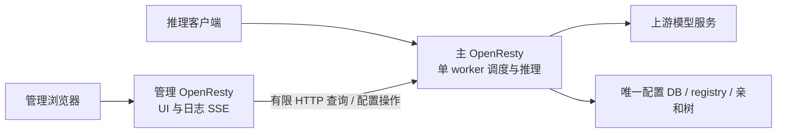

# 双 OpenResty 的管理负载分离

## 选择与目的

针对 [21.k CPU 事故](incident-21k-cpu-20261014.md)，优先修复管理 SSE 的断连退出，再采用两个独立 OpenResty master：**主实例持有推理与全部权威状态，管理实例直接承载 UI 和管理 SSE。**

本方案是研究设计，未实现或部署。它让管理长连接的输出链与推理事件循环分开；不能替代断连清理修复，也不能承诺主实例满核时所有需要 RPC 的管理操作仍然快速。

## 两个进程的职责

| 职责 | 主实例 | 管理实例 |
|---|---|---|
| 推理与虚拟入口 Bearer 门槛 | 完整现行路径 | 不承担推理 |
| config / CAS / DB 与 JSON 镜像 | 唯一写者与权威热视图 | 有限请求转发，不直接写库或镜像 |
| registry、健康、熔断、容量、GPU 与 watcher | 唯一 owner，现行行为保留 | 不运行第二套发现、探针或 registry |
| cache-aware 入口亲和树 | 保持一入口一棵树 | 不复制或维护树 |
| 日志环 / 请求统计 / 主指标 | 保留真实请求的权威状态 | 按游标有限查询，另报本地 SSE 连接/取消指标 |
| UI 静态资源与管理 SSE 输出 | 后续分离模式下不直接对外提供长流 | 直接向浏览器发送日志 SSE、模型进度 SSE |

独立 master 的 `lua_shared_dict` 完全不共享；共享 SQLite 文件也不会共享 registry、在途数或热缓存。管理实例不启动完整 router 状态面，避免配置视图分叉、重复探针、并发上限被放大两倍和亲和树分裂。

## 日志传递与控制请求

管理实例通过本机 Unix socket 或隔离内网连接主实例，使用有限的日志游标查询：请求带 cursor 与 limit，响应包含有序记录、返回 cursor、当前 head 及是否因环覆盖跳过。每次查询完整结束后，管理实例再向浏览器发 SSE；不把主实例的 `/logs/stream` 原样反代出来，否则主实例仍保有每个浏览器长连接和输出链。

当前 `logstore.snapshot` 与 `/logs?after=` 可作为基础，但需要确认序号缺口、过滤条件、覆盖跳过与 cursor 更新的统一契约；不能先截取最近 N 条再无声遗漏中间记录。轮询与历史 SSE 的 0.5 秒节奏、15 秒 ping 对齐；暂停或断连时停止轮询。缓存或背压处理必须有界，并明确丢失/覆盖状态，不无界缓存请求日志。

`/config*`、`/workers`、`/stats` 等有限管理操作仍由主实例执行，管理实例负责既有管理入口与请求转发。新配置立即作用于同一主实例，不引入第二套 revision 快照和失效机制。主实例不可用时，管理实例可以继续提供静态页和自己的健康状态，但不能把旧配置或 worker 状态冒充当前值。

## 信任边界

维持现行管理 Basic Auth 和虚拟入口 Bearer key 两道例外，不新增全局调用方鉴权或第三种内部认证协议。管理实例面向浏览器的路径必须覆盖既有管理路径清单；主实例的内部监听不得成为外部绕过入口。通过 Unix socket 或隔离网络限制访问，具体代理头必须按 `admin_auth` 的“头名出现即撤销 loopback 豁免”规则验证。

不能把浏览器错误凭据静默替换为合法管理凭据来绕过入口认证；也不能因为代理到主实例的 remote_addr 是 loopback 就声称外部管理请求安全。新增路径、头转发、Basic Auth 和匿名推理/metrics/健康豁免需要端到端验证。

## 已完成的隔离 PoC

同一冻结镜像上的最小端点实验，13 条高频长流与 20Hz 控制探针，约 20 秒饱和窗口：

| 实验形状 | 控制探针 p95 | 最大延迟 |
|---|---:|---:|
| 单 master 同时输出流与响应控制探针 | 361.6 ms | 2777 ms |
| 两个完整 listener 通过 reuseport 分担 | 207.3 ms | 810 ms |
| 控制探针独占另一 master | 6.11 ms | 9.36 ms |

该实验只证明独立低负载进程能保护控制探针，未包含真实配置、registry、日志游标、认证或 scheduler 接线，也没有采到生产同样的热点。engine 和代理端点在同一实验进程，不能用其 CPU 判断某个输出模块的成本。`reuseport` 对照不是推荐的产品架构。

## 落地顺序与验收

1. 修正 `handle_logs_stream` 与 `models_sse` 的 print/flush 返回值检查，覆盖正常空闲、首次 flush、RST/FIN、浏览器重连与上游异常。确认断连后协程和链状态停止增长，保留流式即时性。
2. 在独立测试环境实现管理实例的有限游标查询到 SSE 的最小切片；主实例仍唯一维护所有状态。确认日志顺序、cursor、环覆盖、认证与断连停止查询。
3. 验证配置 CAS 冲突 409、热变更、worker 容量与健康、管理 API 和推理 API 的原有字节契约。配置存储验证先确认 sqlite backend 指标。
4. 测试主实例拥堵/不可达、管理实例重启、慢浏览器与多次重连。分别报告推理和管理延迟、CPU、活动 SSE 与取消计数。管理缓存失效不得变成静默旧状态。
5. 实现跨组件接线后，按 testing-workflow 的相关分组加 contract 验证；发布与生产镜像替换仍需完整 full 锚点。先在 21.k 测试实例验证，生产切换另需明确授权。

如果以后修复后推理本身仍存在单 worker 容量瓶颈，才另评估“单调度 owner + 多 transport 直接回客户端”。那需要新请求预留、续租、取消、重试和 usage 回传协议，复杂度显著更高，不作为本次日志 SSE 事故的必要改动。

原始设计与 PoC 在 `/data/tmp/lr-chain-1014/design/`、`dual/`，冻结 manifest 为 `/data/tmp/lr-chain-1014/manifest-current.json`。本设计不改生产端口、镜像、配置或容器。
